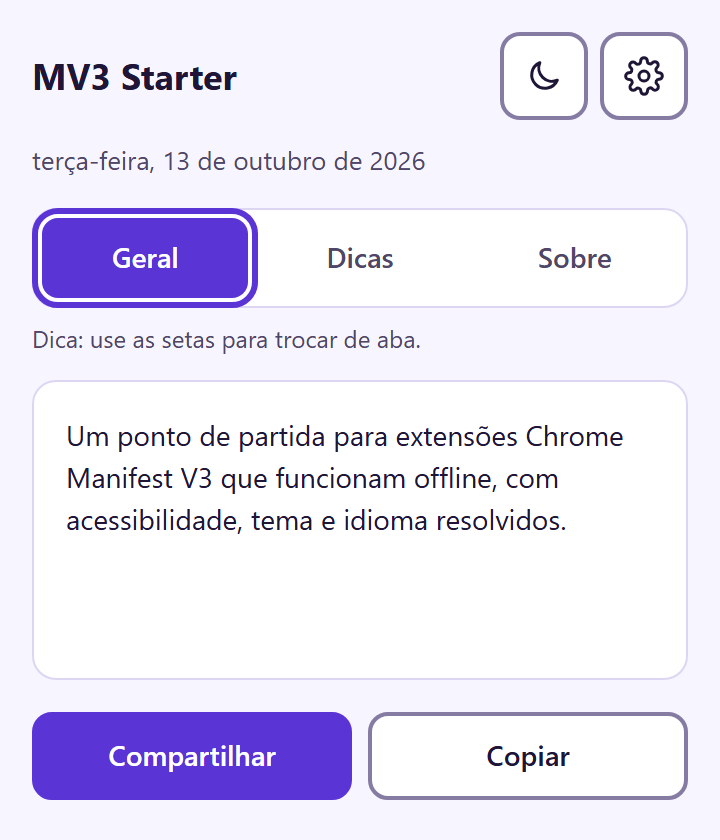
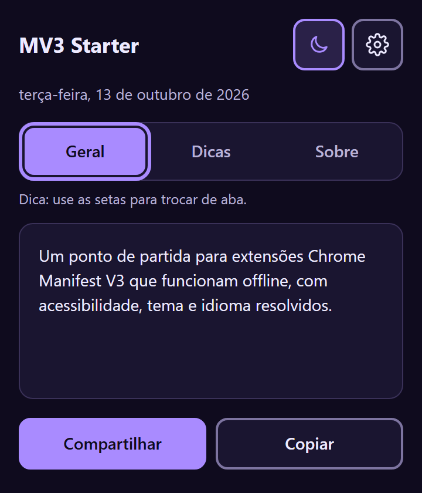
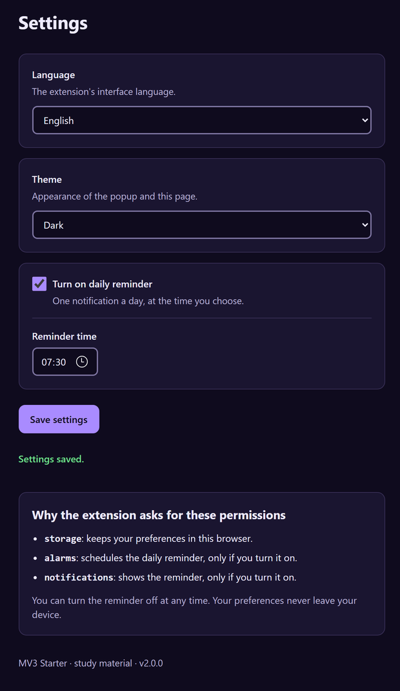

# MV3 Offline Extension Starter

[English](README.md)

Uma extensão pequena para Chrome Manifest V3, sem dependências e sem etapa de build. Funciona offline e já vem com acessibilidade, tema, troca de idioma e um lembrete diário. Dá para fazer um fork e construir sua ideia em cima.

Sou product designer e escrevi esta base para mostrar como cuido das partes de uma extensão que costumam ficar para depois: teclado, retorno para leitor de tela, contraste nos dois temas e permissões que qualquer pessoa entende.

<p>
  
  
</p>



## Como testar

1. Baixe ou clone este repositório.
2. Abra `chrome://extensions` (ou `edge://extensions`) e ative o **Modo do desenvolvedor**.
3. Clique em **Carregar sem compactação** e escolha a pasta do projeto.

Precisa do Chrome 116 ou mais recente.

## O que tem aqui

- **Popup** com abas, a data de hoje no idioma escolhido, botão de tema, Copiar e Compartilhar.
- **Página de configurações** com idioma, tema (sistema, claro ou escuro) e um lembrete diário opcional.
- **Service worker** (módulo ES) que agenda o lembrete e mostra a notificação.
- **Dois idiomas**, português e inglês, com troca na hora. Na primeira vez, segue o idioma do navegador.

## Decisões que valem explicar

### Acessibilidade (WCAG 2.2 AA)

- **As abas seguem o padrão do ARIA Authoring Practices**: setas, Home e End trocam de aba, e o Tab leva direto ao painel. Só a aba ativa entra na ordem de foco.
- **Uma região de status por página** (`role="status"`) avisa "Copiado", "Configurações salvas" e erros. A mensagem é limpa e escrita de novo, então o leitor de tela repete mesmo quando o texto é igual.
- **O botão de tema tem nome fixo** ("Tema escuro") e mostra o estado com `aria-pressed`. Um rótulo que alterna entre "claro" e "escuro" deixa a pessoa sem saber se ele descreve o estado atual ou a ação.
- **O botão Salvar usa `aria-disabled` enquanto salva**, e não `disabled`, para o foco do teclado não voltar para o topo da página.
- **O campo de horário só aparece com o lembrete ligado**, e o checkbox aponta para ele com `aria-controls`.
- **O contraste foi conferido nos dois temas**, incluindo bordas de controles (3:1). Nenhum texto usa opacidade, então as proporções medidas valem na tela. Os valores estão no topo de `src/shared/tokens.css`.
- **O `lang` do `<html>` muda junto com o idioma**, para o leitor de tela trocar a pronúncia.
- Foco visível em tudo, respeito a `prefers-reduced-motion` e ao alto contraste do Windows (`forced-colors`).
- Todas as telas passaram pelo [axe-core](https://github.com/dequelabs/axe-core) nos dois temas e nos dois idiomas, sem nenhuma violação.

### Dois sistemas de tradução, de propósito

O `chrome.i18n` sempre segue o idioma do navegador e não muda em tempo de execução. Como aqui a pessoa escolhe o idioma nas configurações, os textos da interface ficam em `src/shared/i18n.js`. O que o próprio Chrome exibe (nome, descrição, dica do ícone) continua em `_locales/`, como a plataforma espera.

### Um lembrete que não erra no horário de verão

Um alarme que repete a cada 24 horas atrasa ou adianta uma hora quando o horário de verão começa ou termina. Aqui cada alarme dispara uma vez só, no próximo horário escolhido, e é reagendado sempre que dispara. Como o Chrome não garante que alarmes sobrevivam ao fechar o navegador, o service worker confere tudo de novo ao iniciar. Veja `src/shared/reminder.js`.

### Permissões que dá para entender

A extensão pede só `storage`, `alarms` e `notifications`, e a página de configurações explica cada uma em linguagem simples. Nada é enviado para lugar nenhum; tudo fica no `chrome.storage.local`.

## Estrutura

```
mv3-offline-extension-starter/
├── manifest.json          # Manifest MV3: popup, configurações, service worker em módulo
├── background.js          # Service worker: alarme e notificação do lembrete
├── popup.html/.css/.js    # Popup: abas, botão de tema, copiar e compartilhar
├── options.html/.css/.js  # Configurações: idioma, tema, lembrete diário
├── _locales/              # Textos exibidos pelo Chrome (en, pt_BR)
├── icons/                 # 16, 32, 48 e 128 px
└── src/shared/
    ├── tokens.css         # Cores dos dois temas, botões, foco, status
    ├── i18n.js            # Textos da interface e formato de data
    ├── settings.js        # Preferências salvas e aplicação do tema
    ├── reminder.js        # Alarme diário que respeita o horário de verão
    └── announce.js        # Mensagens da região de status
```

## Como adaptar

- Troque os textos em `src/shared/i18n.js`, sempre nos dois idiomas.
- Troque as cores em `src/shared/tokens.css`. Se mexer, confira o contraste de novo nos dois temas.
- Nova preferência: inclua em `DEFAULTS` no `settings.js` e crie o campo em `options.html` com rótulo visível e texto de ajuda.
- Não precisa do lembrete? Apague o `reminder.js`, os listeners de alarme no `background.js` e as permissões `alarms` e `notifications`.

## Licença

MIT, veja [LICENSE](LICENSE).
